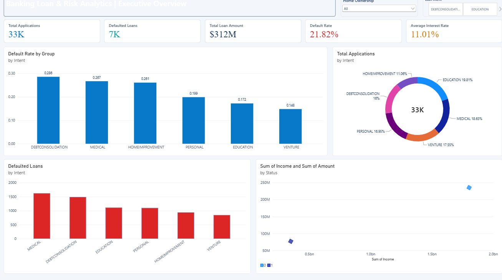
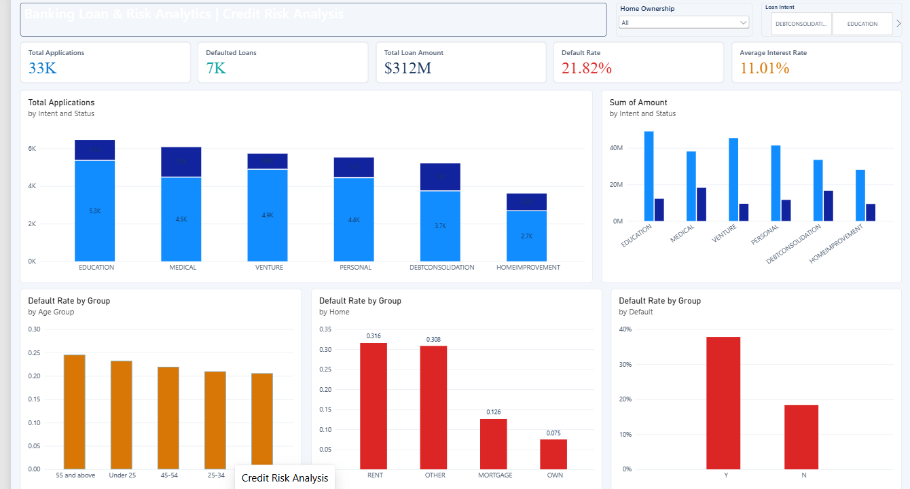
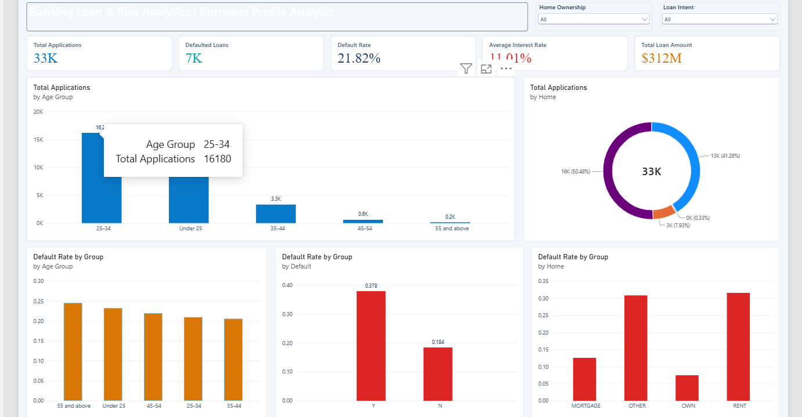
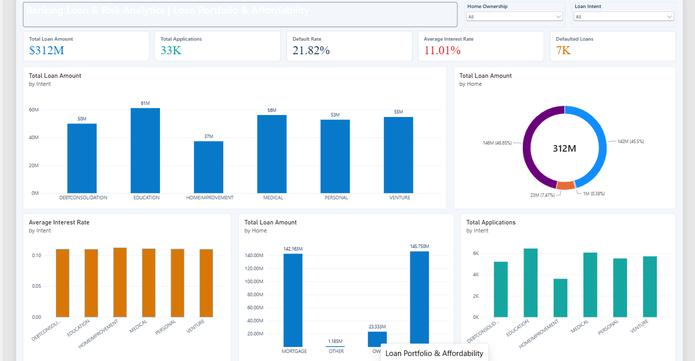

# 🏦 Banking & Loan Risk Analytics Dashboard

[](https://powerbi.microsoft.com/)
[](https://learn.microsoft.com/en-us/dax/)
[](#dataset-overview)
[](LICENSE)

An end-to-end interactive **Banking Loan & Credit Risk Analytics Dashboard** built in **Microsoft Power BI**. This project analyzes over **32,500+ loan applications** totaling **$312M** in credit exposure, uncovering borrower default drivers, risk distributions, interest rate sensitivity, and affordability patterns to support data-driven credit underwriting and risk mitigation.

---

## 📌 Executive Summary & Key KPIs

| Key Performance Indicator | Value | Description |
| :--- | :--- | :--- |
| **Total Loan Volume** | **$312M** | Total disbursed principal across all approved applications |
| **Total Applications** | **32,581 (~33K)** | Total evaluated loan portfolio records |
| **Defaulted Loans** | **7,108 (~7K)** | Number of applications experiencing credit default |
| **Portfolio Default Rate** | **21.82%** | Share of loans defaulting across all categories |
| **Average Interest Rate** | **11.01%** | Portfolio-weighted mean lending interest rate |

---

## 📊 Dashboard Visualizations & Architecture

The report is divided into four dedicated analytical views:

### 1. Executive Overview
Comprehensive portfolio-level summary comparing loan volume, default rates, and application distribution across loan purposes (Education, Medical, Venture, Personal, Debt Consolidation, and Home Improvement).



- **Default Rate by Loan Intent**: Highlights high-risk segments such as **Debt Consolidation (28.6%)** and **Medical (26.7%)**, contrasted with lower-risk purposes such as **Venture (14.8%)**.
- **Portfolio Distribution by Intent**: Donut chart detailing application concentration (**Education 19.8%**, **Medical 18.6%**, **Venture 17.5%**, **Personal 16.9%**).
- **Defaulted Loan Volume**: Absolute counts of defaults per category, pinpointing where risk mitigation produces the largest impact.
- **Income vs. Loan Amount Scatter**: Visual correlation mapping loan sizing versus borrower income stratified by default status.

---

### 2. Credit Risk Analysis
In-depth diagnostic view breaking down credit exposure, delinquency likelihood, and demographic vulnerability across borrower profiles.



- **Application Volume & Status Breakdown**: Stacked visual examining approved vs. defaulted volumes across loan intents.
- **Default Rate by Age Group**: Identifies higher default vulnerability in younger applicants (**Under 25: 23.5%**) and senior cohorts (**55+: 24.8%**), compared to prime-age working professionals (**25–44: ~20.5%**).
- **Default Rate by Home Ownership**: Highlights stark risk divergence: **Renters (31.6%)** and **Other (30.8%)** exhibit nearly triple the default rate of **Home Owners (7.5%)** and **Mortgage holders (12.6%)**.
- **Historical Default Predictor**: Direct correlation showing borrowers with prior defaults (**'Y'**) default at **37.8%**, vs. **18.4%** for clean credit histories.

---

### 3. Borrower Profile Analysis
Customer segmentation dashboard exploring borrower age cohorts, income tiers, and residential stability to refine credit scoring scorecards.



- **Age Group Demographics**: Portfolio heavily concentrated in the **25–34 age bracket (16,180 applications / ~50%)**, followed by **Under 25 (~13K)**.
- **Home Ownership Share**: **Rent (50.48%)** and **Mortgage (41.26%)** represent over 91% of borrower housing structures.
- **Cross-Segment Default Rates**: Direct benchmarking across housing status and prior delinquency records to pinpoint composite high-risk profiles.

---

### 4. Loan Portfolio & Affordability
Focuses on capital deployment, interest rate pricing models, and debt-to-income affordability metrics.



- **Capital Allocation by Intent**: Capital distribution peaked in **Education ($61M)**, **Medical ($56M)**, **Venture ($55M)**, and **Personal ($53M)**.
- **Capital Exposure by Housing**: Portfolio capital split evenly between **Mortgage ($142.2M / 45.5%)** and **Rent ($145.8M / 46.7%)**, with outright owners accounting for **$23.3M (7.5%)**.
- **Interest Rate Consistency**: Visual pricing audit confirming average APR stability (~11.0%) across intents while identifying margin-risk trade-offs.

---

## 📈 Key Business Insights & Recommendations

1. **Collateral & Housing Stability Anchor Credit Risk**:
   - Renters default at **31.6%**, while homeowners default at only **7.5%** (a 4.2x risk difference).
   - *Recommendation*: Introduce tiered loan-to-income caps or collateral requirements for non-homeowners to curtail default loss.

2. **Purpose-Driven Risk Segmentation**:
   - **Debt Consolidation** has the highest default rate (**28.6%**), signaling pre-existing debt stress among applicants.
   - **Venture financing** demonstrated the lowest default rate (**14.8%**) despite representing substantial loan capital ($55M).
   - *Recommendation*: Tighten underwriting verification for debt consolidation applicants (e.g., direct creditor payoff).

3. **Prior Default History is Highly Predictive**:
   - Applicants with prior credit defaults demonstrate a **37.8% default rate**, more than double clean-history applicants (**18.4%**).
   - *Recommendation*: Automate strict risk-adjusted pricing (+250-400 bps) or subprime caps for applicants with prior defaults.

---

## 🛠️ Tech Stack & Tools

- **Business Intelligence**: Microsoft Power BI Desktop
- **Data Modeling & DAX**: Custom KPI measures, dynamic aggregation, time/cohort intelligence
- **Data Transformation**: Power Query / M
- **Source Data**: Structured Credit Risk Dataset (`credit_risk.csv` - 32,581 records)

---

## 📐 Data Dictionary

| Column | Data Type | Description |
| :--- | :--- | :--- |
| `Id` | Integer | Unique identifier for each loan application |
| `Age` | Integer | Borrower age (years) |
| `Income` | Decimal / Integer | Annual borrower gross income ($) |
| `Home` | Text | Home ownership status (`RENT`, `OWN`, `MORTGAGE`, `OTHER`) |
| `Emp_length` | Decimal / Integer | Length of employment in years |
| `Intent` | Text | Purpose of loan (`PERSONAL`, `EDUCATION`, `MEDICAL`, `VENTURE`, `HOMEIMPROVEMENT`, `DEBTCONSOLIDATION`) |
| `Amount` | Decimal / Integer | Loan amount funded ($) |
| `Rate` | Decimal | Interest rate on loan (decimal, e.g., 0.11 = 11%) |
| `Status` | Integer | Loan default status (`0` = Non-default, `1` = Default) |
| `Percent_income` | Decimal | Loan amount as a fraction of annual income |
| `Default` | Text | Historical default record (`Y` = Yes, `N` = No) |
| `Cred_length` | Integer | Length of borrower credit history in years |

---

## 🧮 Core DAX Measures

```dax
// Total Disbursed Capital
Total Loan Amount = SUM(credit_risk[Amount])

// Total Portfolio Size
Total Applications = COUNTROWS(credit_risk)

// Total Defaulted Count
Defaulted Loans = 
CALCULATE(
    COUNTROWS(credit_risk),
    credit_risk[Status] = 1
)

// Portfolio Default Rate
Default Rate = 
DIVIDE(
    [Defaulted Loans],
    [Total Applications],
    0
)

// Portfolio Average Interest Rate
Average Interest Rate = AVERAGE(credit_risk[Rate])
```
*(All measures available in [`DAX_Measures.dax`](./DAX_Measures.dax))*

---

## 🚀 How to Run & View Locally

1. **Clone the repository**:
   ```bash
   git clone https://github.com/HarishReddy-543/Banking-Loan-Risk-Analytics-Dashboard.git
   cd Banking-Loan-Risk-Analytics-Dashboard
   ```

2. **Open in Power BI Desktop**:
   - Double-click [`BANKRISK_Loan_Analytics.pbix`](./BANKRISK_Loan_Analytics.pbix) to open the report.
   - If prompted for the data source path, point Power Query to the local [`credit_risk.csv`](./credit_risk.csv) file.

3. **Interact with the Dashboard**:
   - Utilize slicers for **Home Ownership** and **Loan Intent** to dynamically filter all visualizations across pages.

---

## 👤 Author

- **Harish Reddy**
- GitHub: [@HarishReddy-543](https://github.com/HarishReddy-543)
- Email: [hr3509367@gmail.com](mailto:hr3509367@gmail.com)
